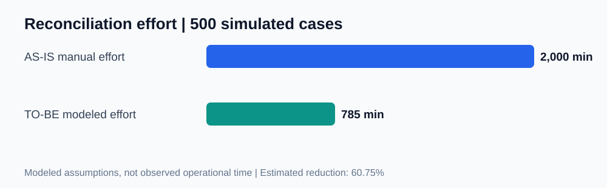
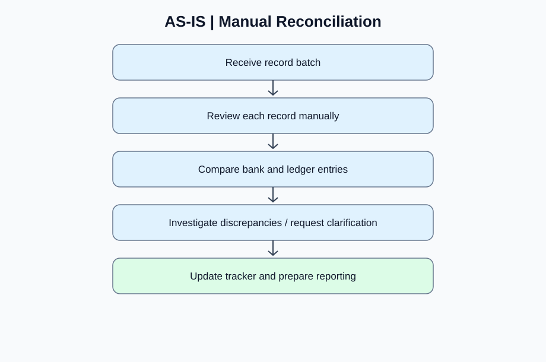
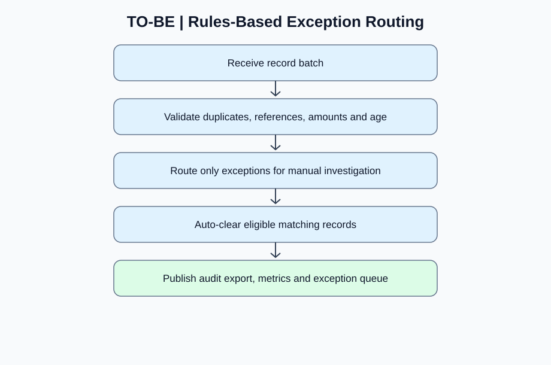

# Banking Operations Workflow Redesign

**End-to-end Business Analyst portfolio case study** | Requirements · Process mapping · SQL · UAT · Traceability

> **Transparency:** This is an independently authored **simulation using synthetic data and hypothetical stakeholder personas**. It is not client work or a deployed banking system. Time savings are model estimates based on declared assumptions, not observed financial-institution outcomes.



## Business question
How could a banking operations team reduce time spent manually reviewing routine reconciliation entries without automatically clearing exception cases?

## Results from a reproducible 500-case simulation
| Measure | Result |
|---|---:|
| Synthetic cases | **500** |
| Eligible auto-clear candidates | **350 (70%)** |
| Exception cases retained for manual review | **150 (30%)** |
| AS-IS workload (assumed 4 min per case) | **2,000 min** |
| TO-BE modeled workload (5 min per exception + 0.1 min oversight per clear case) | **785 min** |
| Estimated time saved | **1,215 min / 20.25 hrs** |
| **Estimated manual handling reduction** | **60.75%** |

### Scenario distribution
| Scenario | Cases |
|---|---:|
| Clean match | 350 |
| Amount mismatch | 60 |
| Duplicate flag | 35 |
| Missing reference | 30 |
| Aged item | 25 |

## Artifacts you can inspect
| Folder | Contents |
|---|---|
| [`requirements/`](requirements/) | BRD, FRD, simulated workshop notes, gap / impact analysis, Agile backlog, **12 user stories** and **25 acceptance criteria** |
| [`process-maps/`](process-maps/) | AS-IS and TO-BE workflow diagrams in `.svg` and editable Mermaid `.mmd` |
| [`traceability/`](traceability/) | Requirements Traceability Matrix: **12** mapped business requirement groups |
| [`uat/`](uat/) | **20** scenario specifications, expected outcomes and review evidence; unit tests separate |
| [`data/`](data/) | 500 seeded synthetic reconciliation records |
| [`analysis/`](analysis/) | Reconciliation rule engine and SQL analysis example |
| [`reports/`](reports/) | Metrics, classified records, gap findings, decision log and recommendations |
| [`assets/`](assets/) | Results visualization |
| [`tests/`](tests/) | Automated Python regression tests |
| `BA_Requirements_and_UAT.xlsx` | Reviewer-friendly traceability and UAT workbook |

## Process maps
**AS-IS**


**TO-BE**


Editable Mermaid source is also included, including decision branches and the rule priority.

## Run locally
Requires Python 3.10+; all core scripts use the Python standard library.

```bash
python3 analysis/workflow_engine.py
python3 analysis/sqlite_demo.py
python3 -m unittest discover -s tests -v
```

The first command regenerates `reports/classified_cases.csv` and `reports/metrics.json`. Expected result: **13 tests passed**. The SQL demonstration uses an in-memory SQLite database.

## What the business analyst actually did in this case study
1. Defined the operational problem, scope and hypothetical stakeholders
2. Developed BRD/FRD, mapped source fields, specified routing rules and assumptions
3. Compared existing and future processes and evaluated change impact
4. Wrote user stories, acceptance criteria and an RTM connecting them to tests
5. Designed UAT scenarios and automated checks against deterministic sample data
6. Communicated the scenario results, limits and decisions required before a real pilot

## Controls and limitations
- Auto-clear is a **candidate routing decision**, not an executed financial transaction
- Exact match and exception categories are seeded intentionally in a synthetic dataset
- Actual banks require formally approved thresholds, historical data validation, access controls, and signed UAT
- The exception counts are not a measure of fraud or real market losses
- No client meetings, sprint ceremonies, or approvals actually occurred; the documentation models them

## Portfolio resume claim (only after reviewing and validating this repository)
*Designed a 500-case reconciliation workflow simulation with 12 user stories, 25 acceptance criteria and 20 UAT scenarios; modeled 60.75% less manual handling effort while routing 150 exceptions for review*
